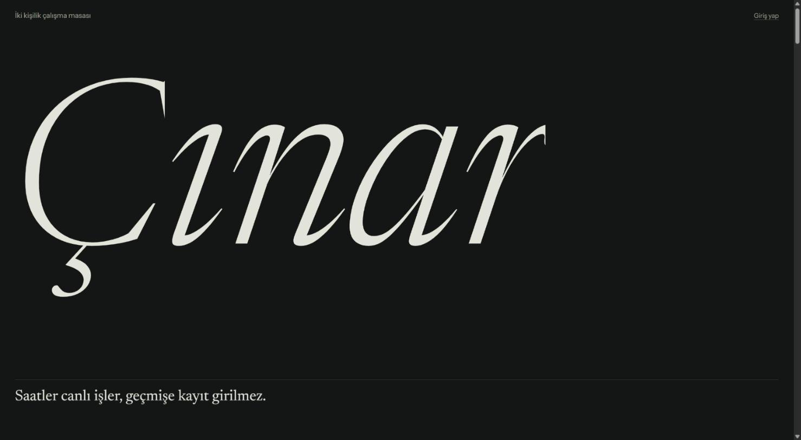
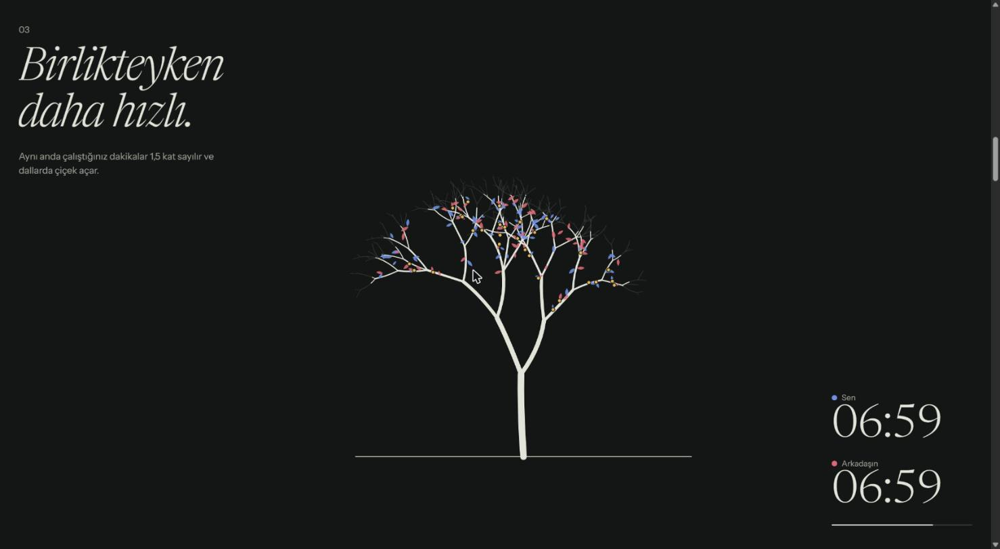
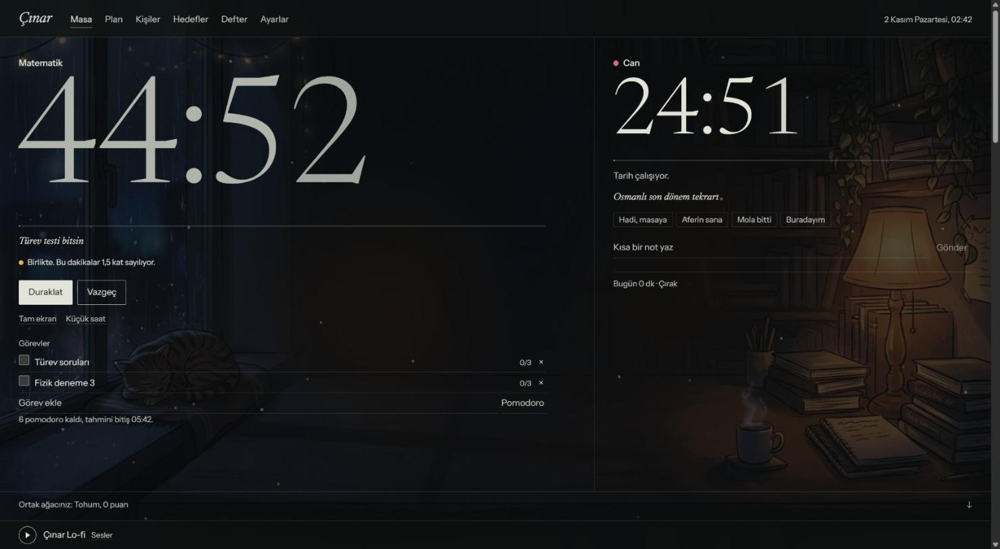
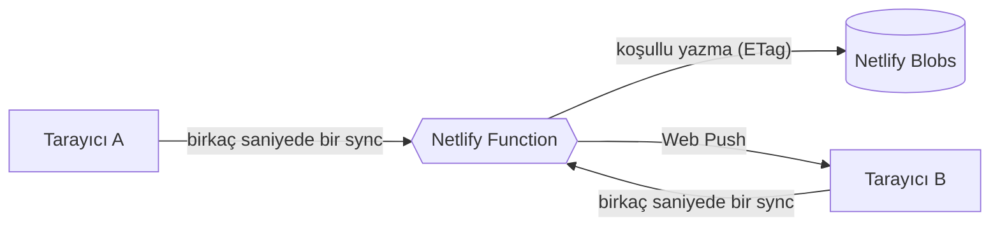

<p align="center">
  
</p>

<h3 align="center">Yalnız çalışmak zor. Karşında biri varken başlamak kolay.</h3>

<p align="center">
  İki kişilik canlı çalışma masası. Saatler aynı anda işler, geçmişe kayıt girilmez,<br>
  siz çalıştıkça ortak ağacınız büyür.
</p>

<p align="center">
  <a href="https://cinar-calisma.netlify.app"></a>
</p>

<p align="center">
  
  
  
  
  
</p>

---

## Neden farklı?

Çoğu pomodoro uygulaması bir geri sayımdır. Çınar ise bir **masa**: karşında arkadaşının saati canlı işler, ne çalıştığını görürsün, tek dokunuşla derse çağırırsın.

<table>
<tr>
<td width="50%" valign="top">

### Hile yok
Süreyi tarayıcı değil **sunucu** sayar. Elle kayıt girilemez, bağlantının koptuğu süre sayılmaz. Ağaç gerçekten çalıştığınız kadar büyür.

</td>
<td width="50%" valign="top">

### Birlikte daha hızlı
Aynı anda çalıştığınız dakikalar **1,5 kat** puan getirir ve dallarda çiçek açar. Yapraklar kimin çalıştığına göre renklenir.

</td>
</tr>
</table>

<p align="center">
  
  <br><sub>Ağaç her masa için koddan üretilir, ince çizgiler varacağı hâli gösterir.</sub>
</p>

<p align="center">
  
  <br><sub>Çalışma ekranı: iki canlı saat, görevler ve Lo-fi sahnesi.</sub>
</p>

## Neler var?

| | |
|---|---|
| **Canlı masa** | İki saat, kullanıcı adıyla davet, derse çağırma ve kısa notlar. Çevrimiçi kişiler listesi |
| **Saat** | Odak, kısa ve uzun mola, kronometre, otomatik başlatma, tam ekran, üstte duran küçük saat |
| **Motivasyon** | Ortak ağaç, tek başına ve arkadaşla seriler, günlük söz ve ağaca konan kuşlar, rütbeler |
| **Sorumluluk** | Oturum başında söylenen hedef, bitince arkadaşın işaretler: yaptı, kısmen, yapmadı. İsteğe bağlı katı mod |
| **Planlama** | Kişisel ve ortak hedefler, sınav geri sayımı, sürükle-bırak haftalık plan, görev tahminleri ve şablonlar |
| **Defter** | Saat saat gün şeridi, hafta ve ay karşılaştırması, konu dağılımı, altı aylık ısı haritası |
| **Atmosfer** | Telifsiz lo-fi, radyolar, yağmur ve şömine sesleri, YouTube ve Spotify bağlantıları, sahneler, kendi fotoğrafın, efektler |
| **Her yerde** | Uygulama olarak kurulur, telefona uyar, gece ve gündüz temaları vardır, uygulama kapalıyken bildirim gönderir |

## Nasıl çalışır?



- **Süre:** İstemci süre göndermez, yalnızca "buradayım" der. Sunucu iki sinyal arasındaki gerçek süreyi yazar; 150 saniyeden uzun boşluk sayılmaz.
- **Eşzamanlılık:** Yazmalar ETag ile koşulludur, iki istek aynı kaydı birbirinin üstüne yazamaz.
- **Güvenlik:** Şifreler scrypt ile saklanır, giriş jetonlarının yalnızca özeti tutulur, art arda yanlış denemede giriş kilitlenir.

## Puanlama

| Olay | Puan |
|---|---|
| Odaklanılan dakika | 1 |
| Aynı anda çalışılan dakika | 1,5 ve çiçek |
| 15 dakikadan uzun oturumu tamamlamak | +5 |
| Günün sözünü tutmak | +10 ve bir kuş |
| Katı modda uygulamadan çıkmak | Oturum puanı yarıya iner |

## Kendi bilgisayarında çalıştır

```bash
npm install
npm run dev
```

Uygulama `http://localhost:8888` adresinde açılır. Yerel Blobs emülatörü ETag döndürmediği için eşzamanlı yazma koruması ancak canlıda tam çalışır.

```bash
npm test
npm run build
```

Bildirimler için Netlify ortam değişkenlerine `VAPID_PUBLIC` ve `VAPID_PRIVATE` eklenmelidir. Anahtar üretmek için:

```bash
npx web-push generate-vapid-keys
```

## Proje yapısı

```text
netlify/functions/api.mts   Hesaplar, oturumlar, davetler, bildirimler
shared/logic.ts             Süre ve puan kuralları, testleri yanında
src/components/             Masa, Plan, Kişiler, Hedefler, Defter, Ayarlar
src/tree.ts                 Koddan üretilen çınar
src/audio.ts                Radyo, ortam sesleri, alarmlar
src/motion.tsx              Yumuşak kaydırma ve giriş animasyonları
```

## Emeği geçenler

- **Müzik:** TAD, omfgdude ve Holizna'nın CC0 eserleri, [OpenGameArt](https://opengameart.org). Ayrıntı: [CREDITS.txt](public/music/CREDITS.txt)
- **Radyo:** [SomaFM](https://somafm.com), dinleyici bağışlarıyla yayın yapar
- **Sahne görselleri:** Google Flow ile üretildi
- **Yazı tipleri:** Newsreader ve Instrument Sans

## Lisans

Kod [MIT](LICENSE) lisanslıdır. Müzik, yazı tipleri ve radyo yayınları kendi lisanslarına tabidir, MIT kapsamında değildir.
